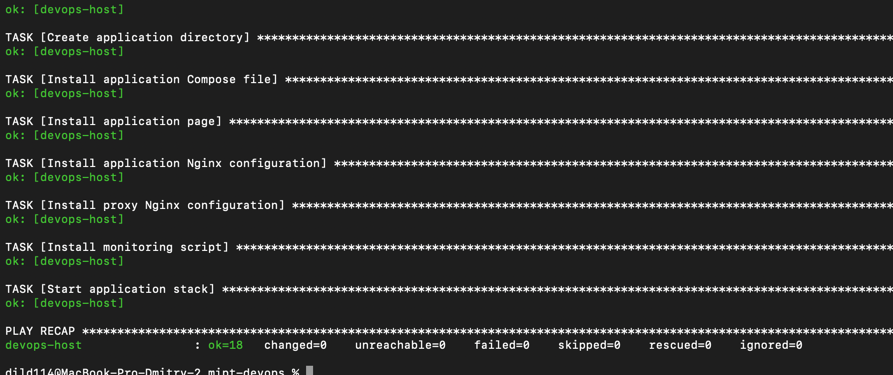
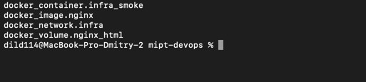
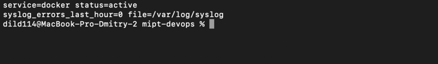
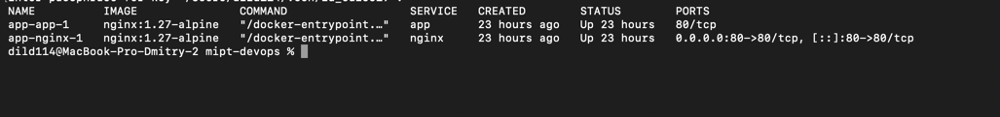
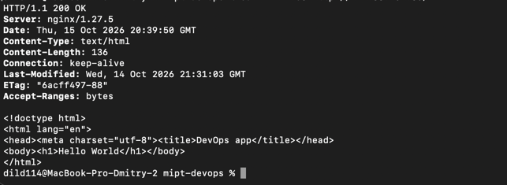

# DevOps homework

## Структура

| Путь | Назначение |
| --- | --- |
| `ansible/` | создание `deployer`, установка Docker и Compose, запуск приложения |
| `terraform/` | локальная Docker-инфраструктура: сеть, image, volume и Nginx на `127.0.0.1:8081` |
| `scripts/monitor.sh` | проверка systemd-сервиса и ошибок в syslog |
| `compose/` | приложение Hello World и Nginx reverse proxy |

Terraform-контейнер находится в сети `devops-infra-network` и использует volume
`devops-infra-html`. Контейнеры Compose находятся в отдельной сети
`app-network`; внешний `nginx` принимает запросы на порту 80 и передаёт их
сервису `app`. Эти сети независимы.

VM `111.88.162.86` уже предоставлена учебным стендом. Поэтому Terraform
управляет локальными Docker-ресурсами на этой VM и не создаёт облачную VM,
VPC или IAM-ресурсы.

## Развёртывание на VM

1. Склонируйте проект и дважды запустите Ansible. Второй запуск должен показать
   `changed=0`, что подтверждает идемпотентность:

   ```bash
   git clone https://github.com/DmitryGavelya/mipt-devops.git "$HOME/mipt-devops"
   cd "$HOME/mipt-devops"
   ansible-playbook -i ansible/inventory.ini ansible/setup_host.yml -k -K
   ansible-playbook -i ansible/inventory.ini ansible/setup_host.yml -k -K
   ```

2. Подключитесь к серверу и перейдите в каталог Terraform:

   ```bash
   ssh student@111.88.162.86
   cd ~/mipt-devops/terraform
   sudo chown -R student:student .
   ```

3. На сервере Terraform запускается из официального Docker-образа. Provider
   Docker хранится в локальном mirror, потому что Terraform Registry
   недоступен из региона сервера:

   ```bash
   terraform_vm() {
     sudo docker run --rm \
       -e TF_CLI_CONFIG_FILE=/terraformrc \
       -v "$PWD:/workspace" \
       -v /tmp/provider-mirror:/provider-mirror:ro \
       -v /tmp/terraformrc:/terraformrc:ro \
       -v /var/run/docker.sock:/var/run/docker.sock \
       -w /workspace hashicorp/terraform:1.13.3 "$@"
   }

   terraform_vm init
   terraform_vm validate
   terraform_vm plan
   terraform_vm apply -auto-approve
   terraform_vm state list
   curl -i http://127.0.0.1:8081/
   ```

   В state ожидаются четыре ресурса:

   ```text
   docker_container.infra_smoke
   docker_image.nginx
   docker_network.infra
   docker_volume.nginx_html
   ```

4. Проверьте мониторинг Docker:

   ```bash
   sudo /opt/app/monitor.sh docker
   ```

5. Проверьте Compose-приложение:

   ```bash
   cd /opt/app
   sudo -u deployer docker compose ps
   curl -i http://127.0.0.1/
   ```

   С другого компьютера выполните:

   ```bash
   curl -i http://111.88.162.86/
   ```

   Ожидаемый результат — `HTTP 200 OK` и страница `Hello World`.

## Проверки для сдачи

Приложите скриншоты следующих результатов:

1. Второй запуск Ansible с `changed=0`:

   ```bash
   ansible-playbook -i ansible/inventory.ini ansible/setup_host.yml -k -K
   ```

   

2. Четыре ресурса Terraform в state:

   ```bash
   terraform_vm state list
   ```

   

3. Работа мониторинга Docker:

   ```bash
   sudo /opt/app/monitor.sh docker
   ```

   

4. Запущенные контейнеры Compose:

   ```bash
   cd /opt/app
   sudo -u deployer docker compose ps
   ```

   

5. Внешняя HTTP-проверка:

   ```bash
   curl -i http://111.88.162.86/
   ```

   

## Что пришлось учесть

Сначала Terraform рассматривался как инструмент создания облачной
инфраструктуры. В учебном стенде облачные ресурсы не предоставляются, а VM
выдаётся заранее, поэтому Terraform был адаптирован под Docker provider и
запускается непосредственно на сервере через Docker socket.

Обычный скачанный Terraform binary и provider Registry на VM недоступны.
Поэтому используется официальный образ `hashicorp/terraform:1.13.3`, а
провайдер Docker устанавливается из локального filesystem mirror.

Ansible настраивает хост и запускает Compose, а Terraform создаёт отдельный
smoke-контейнер на loopback-порту 8081. Это позволяет проверить Terraform и
основное приложение одновременно, не занимая порт 80.

## Git workflow

Рабочая ветка проекта — `feature/infra-setup`. После проверки изменения
передаются в `main` через Merge Request. Версия задания отмечена тегом
`v0.1.0`.
