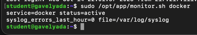
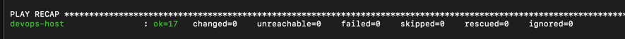
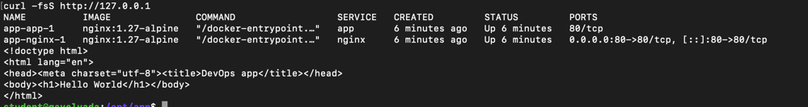

# MIPT DevOps: базовая инфраструктура

Проект поднимает минимальную среду для контейнерного приложения: сеть, подсеть,
виртуальную машину в Yandex Cloud, Docker Engine, Compose и reverse proxy.
Конфигурация разделена по ответственности: Terraform создаёт ресурсы, Ansible
настраивает ОС, а Bash и Compose отвечают за эксплуатацию приложения.


## Развёртывание

### 1. Terraform

Нужны Terraform >= 1.5, аккаунт Yandex Cloud и права на создание Compute,
VPC и service account. Скопируйте `terraform/terraform.tfvars.example` в
`terraform/terraform.tfvars`, заполните значения и задайте токен через
переменную окружения `YC_TOKEN` либо поле `yc_token` (секрет не коммитится).

```bash
cd terraform
terraform init
terraform validate
terraform plan
terraform apply
terraform output instance_public_ip
```

Security group разрешает SSH только из `ssh_cidr` и HTTP на порт 80. Не
используйте `0.0.0.0/0` для SSH. Service account получает только
`compute.editor`, а подключение к VM выполняется ключом пользователя `deployer`.
### 2. Ansible

`ansible/inventory.ini` содержит адрес тестовой VM и подключается существующим
администратором `student`. Для новой VM замените `ansible_host` результатом
`terraform output instance_public_ip`; используйте SSH-ключ администратора:

```bash
ansible-playbook -i ansible/inventory.ini ansible/setup_host.yml \
  --private-key ~/.ssh/id_ed25519 -K
ansible-playbook -i ansible/inventory.ini ansible/setup_host.yml \
  --private-key ~/.ssh/id_ed25519 -K
```

Второй запуск не должен менять ресурсы (ожидаемый итог: `changed=0`; фактический
счётчик может отличаться, если на хосте уже были изменены исходные файлы).
Playbook устанавливает Docker CE и Compose plugin, включает Docker при загрузке,
создаёт `deployer` с passwordless sudo, копирует приложение в `/opt/app` и
запускает Compose от имени `deployer`.

### 3. Compose и проверка

```bash
ssh deployer@VM_IP 'cd /opt/app && docker compose up -d'
ssh deployer@VM_IP 'cd /opt/app && docker compose ps'
curl http://VM_IP
```

Ожидаемый ответ содержит `Hello World`. Сервисы связаны внутренней сетью
`app-network`: внешний `nginx` проксирует запрос на `app`, а `app` отдаёт
статическую страницу своим Nginx.

### 4. Мониторинг

```bash
chmod +x scripts/monitor.sh
./scripts/monitor.sh docker
ssh deployer@VM_IP 'sudo /opt/app/monitor.sh docker'
```

Скрипт завершает работу с ненулевым кодом для неактивного или неизвестного
сервиса и печатает последние 10 строк `journalctl`. Для систем без
`/var/log/syslog` выводит `unavailable`; путь можно передать вторым аргументом,
что удобно для тестирования:

```bash
./scripts/monitor.sh docker ./fixtures/syslog
```

## Проверка результата

Для отчёта подходят выводы следующих команд:

```bash
terraform state list
ansible-playbook -i ansible/inventory.ini ansible/setup_host.yml
docker compose -f compose/docker-compose.yml config
curl -fsS http://VM_IP
```


Проврка


